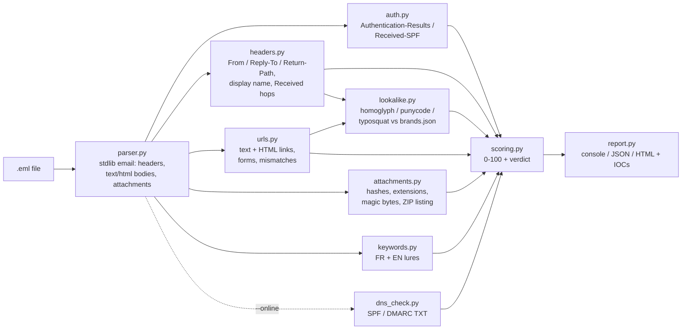

# phishing-analyzer: SOC Level-1 triage for suspicious e-mails

A Python 3.11 command-line tool that triages a reported e-mail (`.eml`) the way a SOC
Level-1 analyst does. It reads the headers, bodies, links and attachments, gives every
finding a weight and a plain-language explanation tied to MITRE ATT&CK, and returns:

- a **risk score from 0 to 100** and a **verdict**: *Likely safe*, *Suspicious* or *Likely phishing*
- a console summary, a **JSON** report for automation, and a **standalone HTML** report (no CDN, no JavaScript)
- a defanged **IOC list** (domains, URLs, IPs, SHA-256 hashes) to paste into the ticket

It runs **offline by default** and uses only the standard library. `--online` adds optional
live DNS lookups of the sender's SPF and DMARC records, which needs `dnspython`.
Attachments are **never executed or opened**. The tool hashes them and inspects them
statically (file name, magic bytes, ZIP directory listing).

> Author: Mohamed Elansari, cybersecurity engineering student at Universiapolis, Agadir.
> Portfolio project. Defensive use only (see [Ethics](#ethics)).

---

## SOC workflow it supports

1. A user clicks "Report phishing", or forwards the message **as an attachment**.
2. The L1 analyst exports the **original message** (`.eml`, with full headers).
3. `phishing-analyzer suspicious.eml --html report.html --json-out report.json`
4. The analyst reads the verdict and the *why* of each finding, then checks the Received chain and authentication.
5. The analyst copies the defanged IOCs into the ticket, then blocks the sender domain and URLs and searches the mail logs for other recipients.
6. The analyst escalates to L2 or a sandbox if there is an attachment or link to detonate, or closes as a false positive and gives feedback to the user.

The tool speeds up steps 3 to 5. It does **not** replace the analyst's judgement: the score is a triage aid, not proof.

## Architecture



Each detector returns `Finding` objects (`models.py`) with `id, category, title, severity,
weight, why, evidence, attack[], iocs[]`. `analyzer.py` puts the findings together, and the
scorer adds them up.

**Scoring rules** (kept simple enough to recompute by hand):

- Each finding id counts **once**, at its highest weight. Ten IP-based links do not make a message ten times more phishing than one.
- The total is capped at 100.
- Below 25 is *Likely safe*, 25 to 59 is *Suspicious*, 60 and above is *Likely phishing*.
- Any `critical` finding raises the verdict to at least *Suspicious*.

## Detections

| Category | Finding id | Weight | What triggers it | ATT&CK |
|---|---|---|---|---|
| Auth | `dmarc_fail` | 30 | DMARC=fail in the trusted Authentication-Results | T1684.002, T1566 |
| Auth | `spf_fail` / `spf_softfail` | 15 / 8 | SPF fail / softfail (also from Received-SPF) | T1684.002 (fail), T1566 |
| Auth | `dkim_fail` | 10 | A DKIM signature is present but invalid, with no other DKIM pass | T1566 |
| Auth | `auth_none` / `auth_missing` | 8 / 5 | No SPF/DKIM/DMARC result at all, or no auth headers | T1566 |
| Auth | `dkim_not_aligned` | 5 | DKIM passes for a different organisational domain than From | T1684.001 |
| Auth | `auth_untrusted` | 5 | No header from the `--authserv-id` you trust | - |
| Auth | `auth_pass` | 0 | Informational: the message passed, which **does not** mean it is legitimate | - |
| Header | `display_name_spoof` | 25 | The display name contains another address, e.g. `"support@microsoft.com" <x@evil.test>` | T1684.002, T1684.001 |
| Header | `reply_to_mismatch` | 20 | The Reply-To organisational domain is not the From domain | T1684.001, T1566 |
| Header | `brand_display_name` | 20 | The display name claims a protected brand from a non-official domain, or from a consumer free-mail address (`"Microsoft Security" <x@outlook.com>`) | T1684.001 |
| Header | `exec_impersonation` | 15 | An executive title (PDG/CEO/DG/DAF...) from a domain outside the recipient's organisation | T1684.001 |
| Header | `return_path_mismatch` | 5 | The envelope sender's domain is not the From domain. Low weight because e-mail service providers do this normally | T1566 |
| Header | `received_missing`, `received_time_travel`, `date_anomaly`, `message_id_mismatch` | 3 to 5 | Hop-chain and timestamp sanity checks | - |
| Lookalike | `lookalike_homoglyph` | 30 | A hostname token whose confusable skeleton equals a brand, e.g. `paypa1`, Cyrillic `а` | T1583.001 + T1566.002 / T1684.001 |
| Lookalike | `lookalike_typosquat` | 25 | Damerau-Levenshtein distance ≤1 from a brand keyword of 6+ chars (≤2 for 9+ chars), same first letter | T1583.001 |
| Lookalike | `lookalike_punycode_mixed_script` / `lookalike_punycode` | 25 / 12 (10 when a brand match already explains it) | `xn--` label; scripts mixed after decoding | T1583.001, T1566.002 |
| Lookalike | `lookalike_brand_wrong_domain` / `lookalike_brand_in_hostname` | 20 / 15 | The brand name appears in a hostname that is not on the official list | T1583.001 |
| URL | `url_text_mismatch` | 25 | The link text shows domain A but the href goes to domain B | T1566.002, T1204.001 |
| URL | `url_obfuscated_ip` / `url_ip_host` | 25 / 20 | Decimal or hex IP, or a raw IP host | T1566.002 |
| URL | `url_userinfo_at` | 20 | `https://www.bank.com@evil.test/`: the real host is the one after `@` | T1566.002 |
| URL | `html_form` | 20 | A `<form>` inside the e-mail that could post credentials | T1598.003 |
| URL | `url_script_scheme` | 20 | `javascript:`, `data:` or `vbscript:` hrefs | T1027.006, T1204.001 |
| URL | `url_shortener` / `url_suspicious_tld` | 10 / 8 | Known URL shortener / TLD often reported as abused (heuristic list) | T1566.002 |
| Attachment | `att_rtlo` | 35 (critical) | A right-to-left override or other bidi character in the file name | T1036.002, T1566.001 |
| Attachment | `att_disguised_exe` | 35 (critical) | The content starts with `MZ` (Windows PE) but the extension is not an executable one | T1036.007, T1204.002 |
| Attachment | `att_double_ext` / `att_padding` | 30 / 10 | `facture.pdf.exe`, or whitespace padding before the real extension | T1036.007 |
| Attachment | `att_executable` | 30 | exe/scr/js/vbs/hta/lnk/ps1/one/... | T1566.001, T1204.002 |
| Attachment | `att_ooxml_vba` / `att_macro_ext` / `att_vba_present` | 30 / 25 / 5 | `vbaProject.bin` hidden in a .docx; .docm/.xlsm...; macro project confirmed | T1566.001, T1204.002, T1059.005 |
| Attachment | `att_disk_image` | 25 | .iso/.img/.vhd (historical Mark-of-the-Web bypass) | T1553.005 |
| Attachment | `att_archive_risky` / `att_archive_encrypted` | 25 / 15 | The ZIP listing contains a script or executable; the ZIP is password-protected | T1566.001 |
| Attachment | `att_html` | 20 | .html/.svg attachment (credential page, HTML smuggling) | T1027.006 |
| Attachment | `att_ole_office` / `att_archive` | 8 / 8 | Legacy OLE Office file; archive that cannot be listed (RAR/7z) | T1566.001 |
| Content | `kw_credential` / `kw_payment` | 15 / 15 | FR+EN credential requests; payment or bank-detail changes (RIB/IBAN/virement) | T1598.003 / T1684.001 |
| Content | `kw_urgency` / `kw_threat` / `kw_secrecy` | 10 each | Deadlines, account-suspension threats, "confidentiel / je suis en réunion" | T1566 / T1684.001 |
| Content | `bec_pattern` | 15 | Payment request plus urgency or secrecy, with **no link and no attachment** (a CEO-fraud mail has no payload) | T1684.001, T1566 |
| DNS (`--online`) | `sender_domain_nxdomain`, `sender_no_spf`, `sender_spf_permissive`, `sender_no_dmarc`, `sender_dmarc_none` | 15 / 8 / 10 / 8 / 3 | Public TXT records of the From organisational domain | T1566 |

**Trust model for authentication headers.** An attacker can write their own
`Authentication-Results: ... dmarc=pass` header. The tool therefore trusts only the
**topmost** header, which your own gateway adds last, or the first header whose
authserv-id matches `--authserv-id`. Sample 06 includes a forged lower header that the
tool ignores.

The "topmost" default is only safe **if your gateway really adds an
Authentication-Results header** to every inbound message. If it does not (or the `.eml`
was exported from somewhere else), the topmost header may be the attacker's own. In
production, always pass `--authserv-id` with your gateway's id; RFC 8601 section 5 also
asks the gateway to delete inbound headers that already carry its own id. Microsoft 365
writes its header without an authserv-id (`Authentication-Results: spf=pass ...`), so
`--authserv-id` cannot match it; there the default "topmost" rule applies.

**ATT&CK version.** Technique ids follow ATT&CK v19 (April 2026), which revoked T1656
*Impersonation* and T1672 *Email Spoofing* and moved them to T1684.001 and T1684.002
under T1684 *Social Engineering*. Older SIEM rules may still use the old ids.

## Installation and usage

```bash
cd phishing-analyzer
python -m pip install -r requirements-dev.txt   # pytest + optional dnspython
python -m phishing_analyzer samples/02_obvious_phishing.eml
# or: pip install -e .   then   phishing-analyzer <file.eml>
```

```text
phishing-analyzer EML [--json] [--json-out PATH] [--html PATH] [--online]
                      [--brands PATH] [--authserv-id ID] [--exit-code]

  --json            print the JSON report instead of the console summary
  --json-out PATH   also save the JSON report
  --html PATH       write the standalone HTML report
  --online          live DNS lookup of the sender's SPF/DMARC (default: offline)
  --brands PATH     your own protected-brands JSON (format: phishing_analyzer/data/brands.json)
  --authserv-id ID  only trust Authentication-Results written by this server
  --exit-code       0 = likely safe, 10 = suspicious, 20 = likely phishing (for SOAR)
```

Exit code 1 means an input error, such as a missing file or an unreadable brands file.

## Samples and results

`samples/` holds **synthetic** messages made by `tools/make_samples.py`. They use only
reserved domains (`example.com`, `.example`, `.test`), documentation IPs (RFC 5737),
fictional people, and attachments that are harmless placeholder text. Results from an
actual run (`python -m phishing_analyzer samples/<file>`):

| Sample | Score | Verdict | Main reasons |
|---|---|---|---|
| `01_legit_newsletter.eml` | 5 | Likely safe | Only `return_path_mismatch` (an e-mail service provider's bounce domain); SPF/DKIM/DMARC pass |
| `02_obvious_phishing.eml` | 100 | Likely phishing | DMARC+SPF fail, `paypa1` homoglyph, link text ≠ target, raw-IP and `@` URLs, Reply-To, lures |
| `03_subtle_lookalike_fr.eml` | 100 | Likely phishing | **All auth passes**, but the From domain is the typosquat `attijariwafabnak` and the link is a Cyrillic-`а` IDN |
| `04_malicious_attachment_fr.eml` | 100 | Likely phishing | `Facture_DHL_0918.pdf.exe` (double ext.), `.docm` with `vbaProject.bin`, DHL display name |
| `05_bec_ceo_fraud_fr.eml` | 85 | Likely phishing | No link and no file: Reply-To diversion, "PDG" from an external domain, virement/RIB + confidentiel + urgent |
| `06_display_name_credential_form.eml` | 100 | Likely phishing | `"support@microsoft.com" <helpdesk@m365-alerts.test>`, password `<form>`, forged auth header ignored |
| `07_gray_shared_document_fr.eml` | 38 | Suspicious | Grey area: SPF softfail, Reply-To to a free-mail domain, 72h deadline; no brand abuse |

Example reports from real runs: [`examples/02_obvious_phishing.html`](examples/02_obvious_phishing.html),
[`examples/02_obvious_phishing.json`](examples/02_obvious_phishing.json),
[`examples/04_malicious_attachment_fr.html`](examples/04_malicious_attachment_fr.html).

### Sample console output (real run, BEC sample)

```text
========================================================================
 PHISHING ANALYZER - SOC L1 triage report
========================================================================
 File        : samples\05_bec_ceo_fraud_fr.eml
 SHA-256     : 6ebfcdabe4ef1dfed949e54c30baddb56365b367365636983e4d22be1860f694
 Subject     : Demande confidentielle
 From        : "Karim Testouni - PDG" <karim.testouni.pdg@direction-acme.test>
 Reply-To    : <k.testouni@securemail-pdg.test>
 Return-Path : <karim.testouni.pdg@direction-acme.test>
 Date        : Mon, 21 Sep 2026 10:47:25 +0100
 Auth        : SPF=pass  DKIM=pass  DMARC=pass  (source: Authentication-Results, authserv-id: mx-in.acme-maroc.example)

 VERDICT     : LIKELY PHISHING   score 85/100

-- Findings (6 scored, 1 informational) --------------------
 [MEDIUM   +20] Reply-To points to a different domain  [T1684.001, T1566]
      why : Replies will go to a different organisation than the visible sender. Attackers use this so the victim's answer (or payment confirmation) reaches a mailbox they control, while From: looks trustworthy.
      seen: From=direction-acme.test  Reply-To=k.testouni@securemail-pdg.test
 [HIGH     +15] Business Email Compromise (CEO/invoice fraud) pattern  [T1684.001, T1566]
      why : Payment request + pressure/secrecy, with no link and no attachment: the attack is the conversation itself, which link and attachment scanners cannot catch. Verify out-of-band (call the requester on a known number) before any transfer.
      seen: keyword groups: payment, secrecy, urgency; header signals: reply_to_mismatch, exec_impersonation
 [MEDIUM   +15] Executive title used by an external sender  [T1684.001]
      ...
 [MEDIUM   +15] Payment / banking change request  [T1684.001]
      seen: matched: 'virement', 'rib', 'iban', 'nouveau rib'
 [LOW      +10] Secrecy / isolation request  [T1684.001]
      seen: matched: 'confidentielle', 'n'en parle a personne', 'je suis en reunion', 'pas joignable'
 [LOW      +10] Urgency pressure  [T1566]
      seen: matched: 'urgent', 'des que possible', 'aujourd'hui meme'
 [INFO     + 0] SPF, DKIM and DMARC all pass
      ...
-- Received chain (oldest hop first) ----------------------------------
  1. from mail.direction-acme.test [198.51.100.140] by mx-in.acme-maroc.example  2026-09-21T09:47:31+00:00
  2. from mx-in.acme-maroc.example [10.1.0.5] by mbox.acme-maroc.example  2026-09-21T09:47:33+00:00 (+2s)

-- IOCs for the ticket (defanged; * = flagged by a rule) ---------------
 domain * direction-acme[.]test
 domain * securemail-pdg[.]test
 ip       198[.]51[.]100[.]140  (received-chain)

 ATT&CK: T1566 Phishing; T1684.001 Social Engineering: Impersonation
```

(`...` marks lines cut from the README; the tool prints them in full.)

## Tests

```bash
python -m pytest        # 93 tests, all offline (DNS is mocked)
```

The tests cover parsing (encoded words, RFC 2231 file names, garbage input, the
unquoted-`@` display-name trick), each detector, scoring thresholds, HTML escaping,
the absence of external resources in the HTML report, terminal escape sequences in the
console output, pathological MIME nesting, ZIP padding evasion, the CLI exit codes, and the
expected verdict of every sample. The sample verdict tests are regression tests: the weights
were tuned on these same samples, so they do not measure real-world accuracy.

## Limitations

These are stated plainly so nobody over-trusts the score.

- **The score is heuristic.** The weights were tuned by hand on the synthetic samples, **not** validated on a real labelled corpus. Expect false positives: real password-reset mail matches the credential keywords, and mail sent through e-mail service providers has a different Return-Path. Expect false negatives too: image-only mail, text obfuscation, Arabic or Darija lures.
- **DKIM is not cryptographically verified.** The tool reads the receiving server's verdict from Authentication-Results. Offline, it cannot re-verify signatures. Re-verifying with `dkimpy` would be a future addition and needs DNS.
- **No detonation and no reputation lookups.** URLs are never fetched or expanded, and attachments are never run. There is no VirusTotal or threat-intel query; you can submit the hashes yourself.
- **Static attachment checks only.** The tool reads file names, magic bytes and ZIP listings. It does not extract or analyse macros (use `oletools`/`olevba` in a sandbox), does not parse PDFs (embedded JavaScript, links), and does not list RAR/7z archives.
- **Nested messages.** For an attached `message/rfc822`, its bodies and attachments are analysed, but its own headers are not evaluated separately.
- **Domain logic is approximate.** `org_domain()` uses a short list of multi-part suffixes, not the full Public Suffix List. The brand list is a starting point: **verify each official domain** before you rely on it.
- **QR-code phishing (quishing)** inside images is not detected, because there is no OCR or QR decoding.
- `--online` checks only the sender domain's SPF and DMARC TXT records. NXDOMAIN is expected for the `.test` samples.

## Ethics

- This is a **defensive** tool for analysing mail you are authorised to handle, such as your organisation's reported-phishing mailbox or your own inbox.
- Real reported e-mails contain **personal data**, so handle them under your organisation's policy (Morocco's law 09-08 / CNDP, GDPR in the EU). Do not upload them to public services, and do not commit them to git (`.gitignore` excludes `reports/` and `*.local.eml`).
- Never click links or open attachments from a suspicious message outside an isolated sandbox. The HTML report shows URLs **defanged and not clickable**, and never renders the e-mail's own HTML.
- The bundled samples are synthetic. Do not use this project to write phishing.

---

## Résumé en français

**phishing-analyzer** est un outil en ligne de commande (Python 3.11, bibliothèque standard)
qui fait le **triage d'un e-mail suspect (.eml)** comme un analyste SOC de niveau 1. Il
analyse :

- l'authentification : SPF, DKIM et DMARC lus dans `Authentication-Results`, en ne faisant confiance qu'à l'en-tête le plus haut ;
- les incohérences d'en-têtes : From, Reply-To, Return-Path, usurpation du nom affiché, titre de PDG venant d'un domaine externe ;
- la chaîne `Received` ;
- les **domaines sosies** : homoglyphes, punycode, typosquatting face à une liste de marques (banques marocaines et grandes marques) ;
- les liens : IP brute, `@`, texte affiché différent de la cible, formulaire, raccourcisseurs ;
- les pièces jointes, analysées en statique et **jamais exécutées** : SHA-256, double extension, RTLO, macros ;
- les leviers d'ingénierie sociale, en français et en anglais.

Il produit un **score de 0 à 100**, un verdict (*Likely safe / Suspicious / Likely phishing*),
une explication pour chaque alerte avec sa référence MITRE ATT&CK, un rapport JSON et HTML
autonome, et la liste des IOC « défangés » prête pour le ticket. Le mode `--online`
(facultatif) interroge le DNS public pour les enregistrements SPF et DMARC de l'expéditeur.
Les 7 échantillons fournis sont synthétiques, et les 93 tests passent hors ligne. Les limites
sont listées plus haut : le score est heuristique et non validé sur un corpus réel, et la
signature DKIM n'est pas re-vérifiée. Voir **LEARN.md** pour les explications détaillées en français.

## License

MIT, see [LICENSE](LICENSE).
